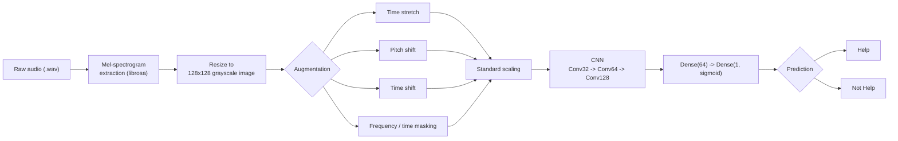

# Audio Distress Call Detection (CNN)

A convolutional neural network that listens to a short audio clip and classifies it as **"Help"** (a distress / help call) or **"Not Help"**. Audio is converted to mel-spectrogram images, augmented, and fed into a CNN trained for binary classification.

> **Why this matters:** systems like smart speakers, home security devices, and public safety monitoring increasingly need to recognise spoken distress signals, not just keywords. This project is a small proof of concept for that pipeline, built end-to-end from raw `.wav` files to a trained, evaluated classifier.

## Pipeline



## Dataset

- Binary classes: **Help** vs **Not Help**, stored as two label folders of `.wav` files under `Dataset/raw_data/`.
- Each clip is converted to a mel-spectrogram, rendered as an image, and resized to `128x128` (grayscale).
- The augmented training set (`CNN_Model.ipynb`) expands every clip into 5 variants (original + time-stretch + pitch-shift + time-shift + a noise/masking pass), taking the dataset from 840 to 4,200 samples before the 80/20 train/test split.
- The raw audio and generated spectrogram images are **not** committed to this repo (see `.gitignore`) — only the code to regenerate them.

The audio clips were self-collected and recorded, rather than pulled from a public dataset.

## Model architecture

A small CNN trained with RMSprop and binary cross-entropy:

| Layer | Details |
|---|---|
| Conv2D | 32 filters, 3x3, ReLU |
| MaxPooling2D | 2x2 |
| Conv2D | 64 filters, 3x3, ReLU |
| MaxPooling2D | 2x2 |
| Conv2D | 128 filters, 3x3, ReLU |
| Flatten | — |
| Dense | 64 units, ReLU |
| Dense | 1 unit, sigmoid (binary output) |

Input: `128x128x1` standardized spectrogram images. Trained for 30 epochs, batch size 32, with a held-out validation split.

## Results

| Run | Train/Test size | Accuracy | Precision | Recall (Sensitivity) | Specificity | F1 |
|---|---|---|---|---|---|---|
| Without augmentation (`EDA.ipynb`) | 672 / 168 | 0.982 | 0.976 | 0.988 | 0.977 | 0.982 |
| **With augmentation** (`CNN_Model.ipynb`) | 3,360 / 840 | **0.995** | 0.998 | 0.993 | 0.998 | 0.995 |

Confusion matrix, augmented run (rows = actual, columns = predicted):

| | Predicted: Not Help | Predicted: Help |
|---|---|---|
| **Actual: Not Help** | 409 (TN) | 1 (FP) |
| **Actual: Help** | 3 (FN) | 427 (TP) |

Augmentation roughly halved the error rate and made the model noticeably more robust, at the cost of a longer training time (5x the data).

> _Add the training-curve and confusion-matrix plot images to a `results/` folder and reference them here, e.g. ``, so results are visible without re-running the notebooks._

## Repository structure

```
.
├── EDA.ipynb          # Exploration: raw audio -> spectrogram, baseline CNN (no augmentation)
├── CNN_Model.ipynb     # Full pipeline: augmentation + CNN training + evaluation
├── requirements.txt    # Python dependencies
└── README.md
```

## Setup & usage

```bash
# clone and install dependencies
git clone https://github.com/Ifuwelemuel/ai_assignment.git
cd ai_assignment
pip install -r requirements.txt

# place your audio dataset at Dataset/raw_data/<label>/*.wav
# then open and run the notebooks in order:
jupyter notebook EDA.ipynb        # exploration + baseline model
jupyter notebook CNN_Model.ipynb  # augmented training pipeline
```

## Limitations & future work

- No held-out, unseen-speaker test set — accuracy may be optimistic if the same speakers/recording sessions appear in both train and test splits.
- The two notebooks duplicate most of their preprocessing code; a shared `src/` module would remove the duplication and make the pipeline easier to reuse.
- No saved model artifact or inference script yet — adding a `predict.py` (or a small Gradio/Streamlit demo) that takes a new `.wav` file and returns a prediction would make this runnable without retraining.
- Trained and evaluated on a relatively small, binary dataset; extending to multiple distress categories (e.g. scream, call for help, alarm) or noisy real-world audio would be a natural next step.

## License

MIT — see [LICENSE](LICENSE).
